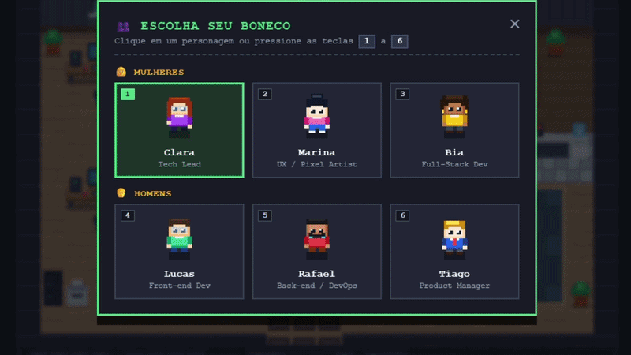

# 🏢 Mini Pixel Office — Ambiente Virtual Interativo 2D


Um ambiente virtual simples estilo **Pixel Art Top-Down** (visto de cima, inspirado em *Gather.town* e RPGs clássicos 16-bits) construído 100% com **HTML5 Canvas, CSS3 e JavaScript puro**, sem necessidade de imagens externas ou bibliotecas.

<p align="center">
  
</p>

> 💡 **Projeto criado pelo grupo [Mulheres Programando](https://mulheresprogramando.substack.com/) para fins educativos!** 

---

## ✨ Funcionalidades

- 🎨 **Pixel Art Procedural 16x16**: Todos os pisos, móveis, animações e personagens são desenhados via código em resolução nativa de `384x256` (`24x16` tiles) com *Integer Scaling* para manter os pixels sempre nítidos.
- 🏢 **3 Áreas de Escritório Detalhadas**:
  - **Estações de Trabalho**: 4 mesas completas com computadores, monitores simples e duplos com linhas de código animadas, canecas de café soltando fumaça, cadeiras ergonômicas, rack de servidores com LEDs piscando, impressora e quadro Kanban.
  - **Biblioteca & Estante de Livros**: Piso de nogueira, tapete de leitura e 3 grandes estantes repletas de livros coloridos, pastas e troféu da equipe.
  - **Lounge & Copa**: Tapete aconchegante, sofá de 3 lugares com almofadas, poltrona de leitura, mesa de centro com tampo de vidro e copa equipada com cafeteira expresso e bebedouro com bolhas animadas.
- 👥 **6 Bonecos Jogáveis (3 Mulheres e 3 Homens)**:
  - Seletor interativo com prévia animada em tempo real e troca rápida pelas teclas `1` a `6`:
    - **Clara** (*Tech Lead*) · **Marina** (*UX / Pixel Artist*) · **Bia** (*Full-Stack Dev*)
    - **Lucas** (*Front-end Dev*) · **Rafael** (*Back-end / DevOps*) · **Tiago** (*Product Manager*)
- 📐 **Profundidade Dinâmica (`Y-Sorting`) & Colisões**: O personagem passa por trás ou pela frente dos móveis de forma natural e pode **sentar nas cadeiras, no sofá e na poltrona**.

---

## 🎮 Controles do Teclado

| Tecla | Ação |
| :--- | :--- |
| <kbd>W</kbd> <kbd>A</kbd> <kbd>S</kbd> <kbd>D</kbd> ou <kbd>↑</kbd> <kbd>←</kbd> <kbd>↓</kbd> <kbd>→</kbd> | Movimentar o boneco pelo escritório |
| <kbd>Shift</kbd> | Correr |
| <kbd>E</kbd> ou <kbd>Espaço</kbd> | Interagir com objetos / Sentar ou levantar de cadeiras e sofá |
| <kbd>P</kbd> | Abrir / fechar o seletor de personagens |
| <kbd>1</kbd> a <kbd>6</kbd> | Trocar de boneco instantaneamente |
| <kbd>G</kbd> | Mostrar / ocultar a grade de tiles (`16x16`) |
| <kbd>C</kbd> | Mostrar / ocultar o mapa de colisões |
| <kbd>L</kbd> | Mostrar / ocultar os rótulos das áreas |
| <kbd>Esc</kbd> | Fechar janelas de diálogo / levantar do assento |

---

## 🧠 Como Funciona por Dentro

### 1. Game Loop
O jogo é uma função que roda ~60 vezes por segundo: **atualiza o estado → desenha a tela → repete**.

```js
function render() {
  updatePlayer();          // lê teclado, move, checa colisão
  ctx.drawImage(bgCanvas, 0, 0); // desenha o chão (pré-renderizado)
  // ...desenha móveis e personagem
  requestAnimationFrame(render);
}
```

> 📌 O chão nunca muda, então ele é desenhado **uma única vez** num canvas fora da tela (`bgCanvas`) e só copiado a cada frame. Uma otimização simples e muito usada.

### 2. Pixel Art Nítida (Integer Scaling)
O mundo é desenhado em apenas `384x256` pixels e ampliado via CSS. Para o navegador não "borrar" os pixels:

```css
canvas { image-rendering: pixelated; }
```
```js
ctx.imageSmoothingEnabled = false;
```

O zoom é sempre um número inteiro (2x, 3x, 4x). Com 2.5x, alguns pixels ficariam maiores que outros.

### 3. Tilemap: o mundo é uma matriz
O mapa é uma grade `24x16` em que cada número representa um tipo de piso:

```js
// 0 = borda, 1 = parede, 2 = madeira, 3 = biblioteca, 4 = tapete, 5 = copa
const floorMap = [
  [0,0,0,0, ...],
  [0,1,1,1, ...],
  [0,2,2,2, ...],
];
```

Para converter posição em pixels → tile: `col = Math.floor(x / 16)`.

### 4. Colisão por grade
Uma segunda matriz (`collisionMap`) guarda `true` onde não dá para andar. Antes de mover, testamos os **4 cantos dos pés** do personagem. Os eixos X e Y são testados **separadamente**, o que permite "deslizar" pelas paredes ao andar na diagonal.

```js
if (canMoveTo(player.x + vx, player.y)) player.x += vx;
if (canMoveTo(player.x, player.y + vy)) player.y += vy;
```

### 5. Y-Sorting (profundidade)
Em visão top-down, **quem está mais embaixo na tela é desenhado por último** (fica na frente). Basta ordenar tudo pela base:

```js
renderList.sort((a, b) => a.sortY - b.sortY);
```

### 👤 Personagens como dados
Os 6 bonecos não são imagens: cada um é um objeto de configuração lido por uma única função de desenho (`drawCharacterSprite`).

```js
{ name: 'Rafael', skin: '#d99066', hairStyle: 'fade', top: '#b91c1c', accessory: 'beard_headphones' }
```

Criar um novo personagem = adicionar um objeto ao array `CHARACTERS`.

---

## Desafios para Praticar

Quer aprender mexendo no código? Tente, do mais fácil ao mais difícil:

1. 🟢 **Mude o layout**: edite números no `floorMap` e veja o piso mudar.
2. 🟢 **Crie o 7º personagem**: adicione um objeto em `CHARACTERS` com suas cores favoritas.
3. 🟡 **Novo móvel**: use `addFurniture()` para colocar uma planta ou um arcade no lounge.
4. 🟡 **Ative o debug**: pressione <kbd>C</kbd> e <kbd>G</kbd> e observe como a colisão se relaciona com a grade.
5. 🔴 **NPC andarilho**: crie um personagem que anda sozinho entre pontos usando o mesmo `canMoveTo()`.
6. 🔴 **Câmera**: aumente o mapa para 48x32 e faça a tela seguir o jogador.

---

## 🚀 Como Executar Localmente

Como o projeto não possui dependências externas nem etapa de build, basta clonar o repositório e abrir o arquivo `index.html` no navegador:

```bash
# 1. Clone o repositório
git clone https://github.com/SEU-USUARIO/mini-pixel-office.git

# 2. Entre na pasta do projeto
cd mini-pixel-office

# 3. Abra o index.html no navegador
```

---

## 📁 Estrutura de Arquivos

```text
├── index.html   # Estrutura da página, HUD superior, modais e legenda de atalhos
├── style.css    # Estilização retrô pixelada, escala inteira e layout responsivo
├── office.js    # Motor 2D em Canvas, tiles, móveis, 6 bonecos, colisões e Y-Sorting
└── README.md    # Documentação do projeto
```

---

## 🗺️ Roadmap (Próximos Passos)

- [ ] Adicionar NPCs (colegas de trabalho) com rotinas pelo escritório
- [ ] Efeitos sonoros 8-bit e som ambiente opcional
- [ ] Sala de reunião com quadro interativo
- [ ] Modo Multiplayer em tempo real (WebSockets)

---

## 💜 Gostou do projeto? 

🎁 Assine nossa newsletter gratuitamente! Além de receber novidades do mundo da programação, você terá acesso à nossa biblioteca de recursos, com guias rápidos, e-book, e outros materiais.

👉 https://mulheresprogramando.substack.com/subscribe

Após se inscrever, você receberá um e-mail de boas-vindas com o link para a página de recursos.

Nos acompanhe também nas redes sociais:

- [Nosso site](https://mulheresprogramando.com.br/)
- [Página no LinkedIn](https://www.linkedin.com/company/mulheres-programando)
- [Grupo no Facebook](https://www.facebook.com/mulheres.programando/)
- [Instagram](https://www.instagram.com/mulheresprogramando.oficial/)
- [Pinterest](https://br.pinterest.com/mulheresprogramando/)
- [Nossa loja na Amazon](https://www.amazon.com.br/shop/mulherespro0b)

Caso se interesse por **Inteligência Artificial**, acesse também a newsletter [Explorando a IA](https://elisaterumi.substack.com/)!

⭐ Se este projeto te ajudou a aprender algo, deixe uma estrela no repositório!

---

## Star History

<a href="https://www.star-history.com/?repos=mulheres-programando/mini-pixel-office&type=date&legend=top-left">
  <picture>
    <source media="(prefers-color-scheme: dark)" srcset="https://api.star-history.com/chart?repos=mulheres-programando/mini-pixel-office&type=date&theme=dark&legend=top-left" />
    <source media="(prefers-color-scheme: light)" srcset="https://api.star-history.com/chart?repos=mulheres-programando/mini-pixel-office&type=date&legend=top-left" />
    
  </picture>
</a>

---

Feito com ❤️, café e muitos pixels.
